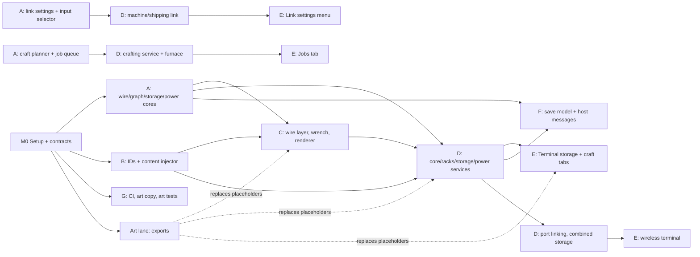

# Stardew Energistics — Code Implementation Plan

Written 2026-11-27, from the approved design (`docs/design-plan.md` v3), `docs/decisions.md`, `docs/HANDOFF.md`, `docs/art-asset-list.md` and `research/`. This file turns the design into code-level work: projects, modules, interfaces, milestones, and the parallel workstreams that can be built at the same time.

The design plan stays the source of truth for *what* the mod does. This file is the source of truth for *how the code is organised and in what order it is built*. Anything here marked **Proposed** is a technical default Claude chose; it is not a confirmed user decision until it is moved into `docs/decisions.md`.

---

## 1. Summary

- **Milestones** keep the design plan's M0–M6 numbering. Each ends in a playable build pushed to the Steam Decks.
- **Seven code workstreams** (lanes A–G) plus the external **art lane**. After a short "contracts" step at the end of M0, lanes A (Core logic), B (content data), C (world layer) and G (infra) can run fully in parallel; D (gameplay services), E (UI) and F (multiplayer/persistence) join as their inputs land.
- **Core first.** All rules that do not need the game (wire graph, storage maths, power, machine input choice, recipe planning, tier gates) live in `StardewEnergistics.Core` with xUnit tests. Core can run one milestone ahead of the game-side code.
- **Art never blocks code.** Every sprite is loaded through one `TextureRegistry` that falls back to a generated placeholder of the right size and frame count. A unit test checks real exports in `artwork/exports/` against the spec, so art problems show up as a failing test, not a broken game.
- **Seven technical spikes** (S1–S7) de-risk the parts of the Stardew API we have not proven yet. Each is scheduled just before the milestone that needs it.

---

## 2. Solution layout

```
StardewEnergistics.sln
src/
  StardewEnergistics.Core/            net6.0 class library. NO Stardew, MonoGame or SMAPI references.
    Geometry/        TilePos, Direction, WireMask (4-bit N=1 E=2 S=4 W=8)
    Wires/           WireLayer, WireTile, WireKind, CableColor
    Graph/           NetworkGraphBuilder, NetworkGraph, BlockNode, BlockKind, GraphIssue
    Power/           PowerTable, PowerLedger, PowerState, Generator fuel rules
    Storage/         ItemKey, DiskTier/DiskSpec, DiskContents, StorageIndex, InsertResult, ExtractResult
    Machines/        LinkSettings, InputRule, KeepBackRule, OutputMode, Schedule, InputSelector, MachineGroupFinder
    Crafting/        RecipeDef, RecipeBook, CraftPlanner, CraftPlan, CraftStep, JobQueue
    Progression/     TierId, TierGate, ProgressSnapshot, GateEvaluator
    Persistence/     SaveModel (versioned DTOs), SaveMigrator
    Art/             AssetSpec, AssetCatalog (the 36 files: name, frame size, frame count)
  StardewEnergistics/                 SMAPI mod (net6.0, Pathoschild.Stardew.ModBuildConfig, EnableModZip)
    ModEntry.cs, ModConfig.cs, manifest.json, i18n/default.json
    Ids.cs                            every namespaced string ID in one place
    Content/         ContentInjector (+ per-asset editors), TextureRegistry, PlaceholderFactory, MailContent
    World/           WireLayerStore, WirePlacement, WireRenderer, WrenchTool, NetworkViewOverlay, BlockRenderer
    Network/         NetworkManager (Core graph per location), LocationKey, PortLinker
    Blocks/          ComputerCore, StorageRack, PowerRack, CraftingRack, Terminal, CoalGenerator, NetworkPort, IslandUplink
    Attachments/     AttachmentService (Chest/Machine/Shipping Link, Power Feed), AttachmentRenderer
    Storage/         StardewItemKeys (Item <-> ItemKey), WholeItemStore, NetworkStorage (disks + Chest Links)
    Power/           PowerService (DayStarted pass, warnings)
    Machines/        MachineDriver (vanilla machine calls), MachineLinkService, ShippingLinkService
    Crafting/        RecipeSource (game recipes -> RecipeBook), CraftingService, FurnaceStepRunner
    Progression/     ProgressionService (Maru mail, recipe unlocks)
    UI/              TerminalMenu (+ StorageTab, CraftTab, JobsTab), LinkSettingsMenu, Meters, Widgets
    Multiplayer/     Messages, HostRouter, ClientProxy, Snapshots
    Patches/         Harmony patches (kept small, one file per patched method)
    Compat/          GenericModConfigMenu integration
    assets/sprites/  (generated at build from artwork/exports; never hand-edited)
tests/
  StardewEnergistics.Tests/          xUnit tests for Core + art export checks
.github/workflows/core-tests.yml      runs Core tests on push (Linux runner; no game needed)
```

**Rules that keep lanes independent**

1. Core never references Stardew types. The mod translates game objects into Core inputs (positions, kinds, `ItemKey`s) and applies Core outputs back. This is what lets lane A run ahead and be tested in a plain shell or CI.
2. Every string ID lives in `Ids.cs` (`StardewEnergistics.ComputerCore`, etc.). Every texture path and frame layout lives in `Core/Art/AssetCatalog.cs`. Lanes never invent IDs or paths locally.
3. One owner folder per lane (see §6). Shared files (`ModEntry.cs`, `Ids.cs`, `AssetCatalog.cs`) change only through small, separate PRs.

---

## 3. Core interfaces (the contracts)

These signatures are fixed at the end of M0 so lanes can build against them. Bodies can change; shapes change only with a note in this file.

```csharp
// Geometry / wires
readonly record struct TilePos(int X, int Y);
enum WireKind { Copper, Heavy }
record WireTile(WireKind Kind, bool Covered, int Color /*0..19, Heavy only*/);
class WireLayer {                                // one per location
  bool TryPlace(TilePos p, WireKind k); bool Remove(TilePos p);
  WireTile? Get(TilePos p); int MaskAt(TilePos p);  // 0..15, frame index
  IEnumerable<TilePos> ConnectedRun(TilePos start); // for "hold wrench to cover a run"
}

// Graph
enum BlockKind { Core, StorageRack, PowerRack, CraftingRack, AdvCraftingRack, Terminal,
                 ChestLink, MachineLink, ShippingLink, CoalGenerator, PowerFeed, Port, Uplink }
record BlockNode(string Id, BlockKind Kind, TilePos Pos);
class NetworkGraphBuilder {
  NetworkGraph Build(WireLayer wires, IReadOnlyList<BlockNode> blocks); // per location
}
class NetworkGraph {           // result: networks + problems
  IReadOnlyList<Network> Networks; IReadOnlyList<GraphIssue> Issues; // e.g. TwoCores, RackNotTouchingCore, NoCore
}

// Power
class PowerLedger {
  int DailyUse(Network n, PowerTable t);
  PowerDayResult RunDay(PowerState s, int use); // batteries first, then generator fuel
  int DaysRemaining(PowerState s, int use);     // drives the 3-day warning
}

// Storage
readonly record struct ItemKey(string QualifiedId, int Quality, string? PreserveId, int? Color);
record DiskSpec(int MaxKinds /* -1 = unlimited */, long MaxItems);
class StorageIndex {
  InsertResult Insert(ItemKey k, int n); ExtractResult Extract(ItemKey k, int n);
  long Count(ItemKey k); IEnumerable<(ItemKey, long)> All();
  int KindsUsed(DiskId d);   // counts base QualifiedId only (quality/flavour don't use kinds)
}

// Machines
record LinkSettings(IReadOnlyList<InputRule> Inputs, IReadOnlyList<KeepBackRule> KeepBack,
                    OutputMode Output, Schedule Schedule, bool Configured);
static class InputSelector { ItemKey? Choose(LinkSettings s, IStockView stock, Func<ItemKey,bool> accepts); }
static class MachineGroupFinder { IReadOnlyList<TilePos> Group(TilePos start, Func<TilePos,string?> machineIdAt); }

// Crafting
record RecipeDef(string Id, IReadOnlyList<(ItemKey item, int n)> In, (ItemKey item, int n) Out,
                 RecipeKind Kind /* Craft, Furnace, Cooking */);
class CraftPlanner { CraftPlan Plan(ItemKey target, int n, RecipeBook book, IStockView stock); } // stock first, then sub-recipes
class JobQueue { /* one active job per Crafting Rack; steps advance on ticks */ }

// Progression
class GateEvaluator { IReadOnlySet<TierId> Unlocked(ProgressSnapshot s); } // hearts, mine level, items crafted, previous tier built
```

**Save model** (`Core/Persistence/SaveModel.cs`, serialised as JSON through `helper.Data.WriteSaveData` on the host):

```
SaveModel { int SchemaVersion;
  Dictionary<LocationKey, WireLayerDto> Wires;     // tiles, kind, covered, colour
  Dictionary<DiskId, DiskContentsDto> Disks;       // ItemKey -> count, plus whole items (serialised)
  Dictionary<NetworkId, PowerStateDto> Power;      // battery charge, generator fuel, last warning day
  List<CraftJobDto> Jobs; ProgressDto Progress; }
```

Per-block settings (Link settings, disk ID on a disk item, rack contents) live in each object's `modData` so they survive pick-up, as the design requires. `SaveMigrator` upgrades old `SchemaVersion`s; a save-breaking change bumps the mod's major version.

---

## 4. How code depends on art

Art is produced in parallel from `docs/art-asset-list.md`. Code depends on **file names, frame size and frame count only**, never on finished pixels.

### 4.1 One catalogue, one loader

- `Core/Art/AssetCatalog.cs` lists all 36 files with frame width, frame height and frame count, copied from the art list (e.g. `computer-core.png 16×32 ×4`, `wire-tiles.png 16×16 ×16`, `settings-icons.png 9×9 ×7`).
- `Content/TextureRegistry` registers each file as its own game asset, `Mods/StardewEnergistics/Sprites/<name>` (e.g. `Mods/StardewEnergistics/Sprites/computer-core`), via `AssetRequested`. `Data/Objects` and `Data/BigCraftables` entries point their `Texture` field at that asset with `SpriteIndex` 0. Because each file is a single left-to-right strip, frame *n* is simply sprite index *n*. **No sheet packing is needed.**
- If `assets/sprites/<name>.png` exists it is loaded; otherwise `PlaceholderFactory` generates a texture of exactly the catalogue size: a flat tier-coloured box with a dark outline, a 1–2 letter label and a frame number, so states are visibly different in game.

### 4.2 Getting exports into the build

- The mod `.csproj` copies `artwork/exports/*.png` into `assets/sprites/` at build time. Dropping a PNG into `artwork/exports/` and rebuilding is all it takes; no code change.
- `tests/…/ArtExportTests` reads each PNG header in `artwork/exports/` (no game needed) and fails if a file's size ≠ `frameW × frames` by `frameH`, if the name is not in the catalogue, or if it has the wrong colour type. Missing files are reported as "placeholder in use", not failures. This gives the art lane a one-command check: `dotnet test`.

### 4.3 Art each milestone needs (placeholders are fine until then)

| Milestone | Asset numbers (art list) | Code that draws them |
| --- | --- | --- |
| M1 | 1–4 processors & spool, 11 press, 21 wire, 22 wire glow, 35 heavy cable, 36 wrench | Data/Objects, Data/BigCraftables, `WireRenderer`, `NetworkViewOverlay` |
| M2 | 5 copper disk, 12 core, 13 storage rack, 14 power rack, 17 terminal, 18 coal generator, 23 chest link, 27 frame, 28 tabs, 30–32 meters & markers | `BlockRenderer`, `AttachmentRenderer`, `TerminalMenu` |
| M3 | 6–7 iron/gold disk, 24 machine link, 25 shipping link, 29 settings icons | `LinkSettingsMenu`, `AttachmentRenderer` |
| M4 | 15 crafting rack | `BlockRenderer`, Jobs tab |
| M5 | 8 iridium disk, 10 wireless terminal, 19 network port, 26 power feed | `PortLinker`, `AttachmentRenderer` |
| M6 | 9 prismatic disk, 16 advanced crafting rack, 20 island uplink, 33 mod icon, 34 Nexus banner | release packaging |

Art-specific code notes:

- **Multi-state blocks** (racks show 0–4 disks, Core shows off/on/blink/low power, Machine Link shows 4 states) need more than vanilla's single "next index" flag. `BlockRenderer` draws our big craftables itself and picks the frame from block state (spike S2).
- **Heavy Cable tint:** drawn with `Color` from the game's 20 chest colours (`DiscreteColorPicker`), so the art stays light grey as the list specifies.
- **Server wall:** racks are separate 1-tile big craftables placed beside each other; the art lines them up. Code only checks adjacency.
- **Wire auto-tiling:** frame = `WireLayer.MaskAt(p)`, exactly the art list's N=1/E=2/S=4/W=8 order.
- **Menus** use `terminal-frame.png` as a 9-slice with 16 px corners; until it exists, vanilla `Game1.menuTexture` frames are used.

---

## 5. Technical spikes

Each spike is a small throwaway branch that proves one API path in the real game and records the answer in this file. A spike blocks only the task listed beside it.

| # | Question | Proves it for | When |
| --- | --- | --- | --- |
| S1 | Where to draw a floor-layer wire so it sits under players/objects and under flooring; detect flooring on a tile to treat wire as covered. Candidate: SMAPI `RenderedStep` (world background step) vs a Harmony postfix on the location's floor drawing. | `WireRenderer` | start of M1 |
| S2 | Drawing our own big craftables with an arbitrary frame (Harmony prefix on `Object.draw` for our IDs only), including the held/inventory draw. | `BlockRenderer`, racks, Core | end of M1 |
| S3 | Opening the vanilla `CraftingPage` with network storage as its material source (1.6 accepts extra material containers; we need an adapter that withdraws from the network, not a real chest). Fallback: our own crafting tab that reuses vanilla recipe drawing. | Terminal craft tab | start of M2 |
| S4 | Persisting whole items (tools, rings, weapons, items with extra modData) inside a disk: XML-serialise with the game's own serialiser into save data vs keep them in a hidden host-side inventory. | `WholeItemStore` | start of M2 |
| S5 | Driving a vanilla machine from code: put an input in (incl. `AdditionalConsumedItems`), detect ready output, collect it, with no player present. Read Automate's approach for ideas, do not copy code. | `MachineDriver` | start of M3 |
| S6 | Mapping a building's interior to its exterior footprint and door tile, placing a block on an outside wall, and joining two `LocationKey`s. Also the Ginger Island farm location. | `PortLinker`, Uplink | start of M5 |
| S7 | Multiplayer: message size/frequency for terminal snapshots and wire layer sync; behaviour when a farmhand opens a Terminal in a building the host has not loaded. | `Multiplayer/` | during M2, hardened in M6 |

---

## 6. Workstreams (lanes)

| Lane | Owns | Needs before starting | Can run alongside |
| --- | --- | --- | --- |
| **A — Core logic** | `src/StardewEnergistics.Core/`, `tests/` | M0 contracts (§3) | everything |
| **B — Content & progression data** | `Content/`, `Progression/`, `Ids.cs`, `i18n/`, `manifest.json` | M0 scaffold | A, C, G |
| **C — World layer** | `World/`, `Patches/` for drawing & input, `Attachments/AttachmentRenderer` | M0 scaffold, S1/S2, wire item ID from B | A, B, G |
| **D — Gameplay services** | `Network/`, `Blocks/`, `Storage/`, `Power/`, `Machines/`, `Crafting/` | Core module for that system (A) + block IDs (B) + graph inputs from C | E once interfaces exist |
| **E — UI** | `UI/` | Service interfaces from D (can start on fakes) | D |
| **F — Multiplayer & persistence** | `Multiplayer/`, save wiring in `ModEntry`, `Core/Persistence` with A | Save model (A) | D, E |
| **G — Infra & QA** | `.github/`, `deploy/`, `tools/`, csproj art copy, test checklists, `Compat/` | none | everything |
| **Art (external)** | `artwork/source/`, `artwork/exports/` | `docs/art-asset-list.md` | everything |

How to run the lanes with several Claude threads: one thread per lane (or per lane-milestone task), each on its own branch from `main`, each touching only its owned folders. Shared files go through small PRs merged first. The milestone integrator (one thread) merges, builds on the PC and runs the milestone's in-game check.

### Dependency graph



Lane A deliberately runs **one milestone ahead**: while the mod is integrating M2, lane A can already be building and testing the M3 input selector and the M4 craft planner.

---

## 7. Milestones

Each milestone lists its tasks by lane, the tests it adds, and its "Done when" check from the design plan. Sizes are rough: **S** ≈ one focused session, **M** ≈ 2–3, **L** ≈ 4+.

### M0 — Setup and contracts

Mostly sequential; the user's PC setup is the critical path.

- **G** Scaffold `StardewEnergistics.sln`, the two `src/` projects and `tests/` (S). Mod project: `net6.0`, `Pathoschild.Stardew.ModBuildConfig`, `EnableModZip=true`, `EnableHarmony=true`. Core project has no game references (enforced by a test that inspects the assembly's references).
- **B** `ModEntry` logs "Stardew Energistics loaded"; `manifest.json` with `UniqueID` `afterian.StardewEnergistics` (confirmed), `UpdateKeys: []`, `MinimumApiVersion` set from the installed SMAPI (S).
- **G** GitHub Actions workflow running `dotnet test tests/` on Linux (Core only) (S).
- **G** Wire `deploy/publish-test.bat` to the real repo `afterian/stardewenergistics`; fill in `deploy/README.md` (S).
- **A** Commit the §3 contracts as stubs with `NotImplementedException` plus `AssetCatalog` with all 36 entries (S).
- **G** `ArtExportTests` and the csproj step that copies `artwork/exports/*.png` (S).
- **User** PC tools (.NET 6 SDK, VS 2022/Rider, SMAPI, Git, `gh auth login`); Deck SMAPI + launch option. Record versions in `docs/decisions.md`.

**Done when:** SMAPI console shows "Stardew Energistics loaded" on the PC and both Decks, and CI is green.

### M1 — Components and wire

Parallel lanes: A, B, C, G.

- **A** `WireLayer`, `WireMask`, `ConnectedRun` with tests for every mask 0–15, placing/removing in the middle of a run, mixed Copper/Heavy (S).
- **A** `SaveModel` v1 for wire layers + round-trip test (S).
- **B** `Ids.cs` for all 26 items; `ContentInjector` for `Data/Objects` (processors, wire, cable, wrench as a tool-like object), `Data/BigCraftables` (Processor Press), `Data/CraftingRecipes` (press, Copper Wire, Heavy Cable), `Data/Machines` (press rules; Gold/Iridium Processor use `AdditionalConsumedItems`; Iridium takes 2 days) (M).
- **B** `TextureRegistry` + `PlaceholderFactory` for M1 assets (S).
- **C** S1 spike, then `WireRenderer` (auto-tile, Heavy Cable tint, skip covered tiles and tiles with flooring) (M).
- **C** `WirePlacement`: using a wire stack on a floor tile places one wire and consumes one item; click-drag lays a line; picking up returns the item (M).
- **C** `WrenchTool`: tap = toggle covered; hold = cover/uncover `ConnectedRun`; on Heavy Cable, a colour-cycle action (S).
- **C** `NetworkViewOverlay`: hotkey (configurable) or holding the wrench draws all wire with `wire-tiles-glow` (S).
- **C** S2 spike (needed by M2, done here so M2 can start on it).
- **F** Save/load the wire layer through `helper.Data` on the host (S).
- **G** In-game test checklist `docs/testing/m1.md` (S).

Temporary: recipes are granted by a debug console command (`se_unlock all`) until lane B adds Maru's mail in M2.

**Done when:** wire laid in a shed still joins up correctly after reload, on PC and Deck.

### M2 — Simple storage and basic crafting

Biggest milestone. Parallel lanes: A (storage/power/graph), B (blocks content + mail), C (block rendering), D (services), E (terminal), F (save + first MP messages).

- **A** `NetworkGraphBuilder`: flood fill from each Core over wire and adjacent blocks; racks join by touching the Core or another rack; issues for two Cores, no Core, rack not touching (M). Tests include a shed layout fixture and the "two Cores" error.
- **A** `StorageIndex` + `DiskSpec` for Copper Disk (20 kinds, 2,000 items); kind counting by base ID; inserts fill disks in rack order, then Chest Links (**Proposed** priority, configurable later) (M).
- **A** `PowerTable`, `PowerLedger`: starter network ≈ 7/day; Battery = 100; generator fuel rules with Coal = 1 power as a **config value** (open item stays open); days-remaining for the 3-day warning (S).
- **B** Content for Core, Storage Rack, Power Rack, Terminal, Coal Generator, Chest Link, Copper Disk, Network Wrench; Maru mail for T1 and T2 (letter text in `i18n/`), gates from `GateEvaluator` (M).
- **C** `BlockRenderer` for Core/racks/terminal/generator with state frames; `AttachmentRenderer` for Chest Link; Network View markers (no power, not set up, full) (M).
- **D** `NetworkManager`: rebuilds a location's graph when wire or a block is placed/removed (`ObjectListChanged` + our wire events), caches it, exposes `Network` lookups by tile (M).
- **D** Racks: insert/remove disks and Battery Packs by clicking with the item (contents in `modData`); disk items carry a `DiskId` in `modData` (S).
- **D** S4 spike, then `StardewItemKeys` (Item ↔ `ItemKey`, quality, preserve/flavour, coloured objects) and `WholeItemStore` for tools/rings/weapons (M).
- **D** `NetworkStorage` over disks + Chest Links (chests, fridge, Junimo chest via `modData` flag on the chest) (M).
- **D** `PowerService` on `DayStarted`: run the ledger, mark networks unpowered, send the warning mail 3 days ahead, Core low-power frame (S).
- **E** S3 spike, then `TerminalMenu`: Storage tab (search, sort, take to inventory, put from inventory, quality/flavour rows), Craft tab (crafting-table behaviour on network storage), power and disk meters (L).
- **F** Host owns state. Farmhand requests: `TakeItem`, `PutItem`, `Craft`, `OpenTerminal`; host replies with a storage snapshot; wire layer synced on change and on peer join (M). S7 measurements here.
- **Decision before closing M2:** Terminal reach before T5 (own building vs all buildings). Implemented behind `ModConfig.TerminalReachAllBeforePorts`, default per the plan (own building only).

**Done when:** a shed network holds 20 kinds and runs two weeks on one Battery Pack; a farmhand in split-screen can take an item from the Terminal.

### M3 — Machine automation

Parallel lanes: A (already done ahead), D, E, B.

- **A** (built during M2) `LinkSettings`, `InputSelector` (priority order, keep-back, only items the machine accepts), `MachineGroupFinder`, `Schedule` (always / hour window) with tests (M).
- **B** Content for Machine Link, Shipping Link, Iron and Gold Disks, Gold Processor unlock, Heavy Cable unlock; T3 mail (S).
- **D** S5 spike, then `MachineDriver` around the game's machine API: can-accept check from `Data/Machines`, place input (incl. extra consumed items), collect output (M).
- **D** `MachineLinkService`: on `TimeChanged`, round-robin through Links within the 1 ms budget; feed each idle machine in the group; collect outputs into storage or leave them; set Link state frames (not set up / idle / working / missing input) (M).
- **D** Overnight pass on `DayEnding` for machines that finished overnight (S).
- **D** `ShippingLinkService`: on `DayEnding`, move "everything above N" of the configured items into the shipping bin (S).
- **E** `LinkSettingsMenu`: inputs list (add, remove, reorder), keep-back amounts, output mode, schedule; copy/paste settings shortcut (settings travel as a clipboard in mod state, per player) (M).
- **F** Settings changes from farmhands go through the host (`SetLinkSettings`) (S).
- **G** Performance harness: a debug command that spawns 100 Linked machines and logs tick time (S).

**Done when:** one configured Link runs 30 Kegs for a whole season.

### M4 — Autocrafting

Parallel lanes: A (planner, done ahead during M3), D, E, B.

- **A** `CraftPlanner`: expand the recipe tree from known recipes, use stock first, add Furnace steps from `Data/Machines` furnace rules, detect missing items and cycles; `JobQueue` with one job per Crafting Rack (M). Golden test: Quality Sprinkler from ore.
- **B** Content for Crafting Rack; T4 mail (S).
- **D** `RecipeSource` turns the player's known recipes and furnace rules into a `RecipeBook` (S).
- **D** `CraftingService` reserves ingredients, runs craft steps instantly and Furnace steps on linked Furnaces through `MachineDriver`, puts results in storage (M).
- **E** Craft tab "request N" button; Jobs tab with progress and cancel (M).
- **F** `RequestCraft`, `CancelJob` messages; jobs in the save model (S).

**Done when:** one request for a Quality Sprinkler smelts its bars from ore and crafts it.

### M5 — Linked buildings

Parallel lanes: D, E, B, A.

- **A** Multi-location graph: `Port` nodes join two location graphs into one farm network; combined `StorageIndex` view across networks; power stays per building (**Proposed**) (M).
- **B** Content for Iridium Processor, Network Port, Iridium Disk, Wireless Terminal, Power Feed; T5 mail (S).
- **D** S6 spike, then `PortLinker`: Port placed on the outside wall tile beside a building's door, matched to that building's interior network; outdoor wire on the Farm runs into the farmhouse Port (M).
- **D** Power Feed: wire to Lightning Rods / Solar Panels; on collection their Battery Packs go to the network's Power Racks (S).
- **E** Terminal shows a building filter and combined storage; Wireless Terminal opens the same menu anywhere on the farm and in linked buildings (S).
- **F** Snapshots for combined views; farmhand requests routed to the right network (S).

**Done when:** the farmhouse terminal shows items from three buildings.

### M6 — Whole farm and release

- **A** Prismatic Disk (unlimited kinds); keep-in-stock rules and scheduled jobs in `JobQueue`; cross-building chains in the planner (M).
- **B** Content for Advanced Crafting Rack, Prismatic Disk, Island Uplink; T6 mail; all tier gates (with a config switch to turn gates off) (S).
- **D** Advanced Crafting Rack service (cooking recipes, keep-in-stock on `DayEnding`); Island Uplink joins the Island farm (M).
- **F** Multiplayer hardening: reconnects, two farmhands editing the same Link, save while a job runs, version mismatch message (M).
- **G** GMCM options (power use, disk sizes, gates on/off, Network View key), `UpdateKeys`, README/Nexus page, mod icon and banner, release zip (S).

**Done when:** two Steam Decks share one linked farm in online co-op.

---

## 8. Testing strategy

| Layer | How | Where |
| --- | --- | --- |
| Core rules | xUnit, fast, every push via CI | `tests/StardewEnergistics.Tests` |
| Art exports | PNG header checks against `AssetCatalog` | same test project |
| Save model | round-trip and migration tests with fixture JSON | same |
| In-game | a short checklist per milestone (`docs/testing/mN.md`) the user follows on the PC, ending with "upload SMAPI log" | PC |
| Multiplayer | split-screen on the PC each milestone from M2; online on the two Decks at M3, M5, M6 | PC + Decks |
| Performance | debug command with 100 Links, tick time logged | PC |

Debug console commands (all prefixed `se_`): `se_unlock <tier|all>`, `se_give <id>`, `se_graph` (print the current location's networks), `se_power <n>`, `se_perf <links>`. These let the user test a milestone without replaying a season.

---

## 9. Open items that touch the code

None of these block starting work; each has a default behind a config value.

| Item | Default in code | Needed by |
| --- | --- | --- |
| Terminal reach before Network Ports | Own building only (`TerminalReachAllBeforePorts = false`) | end of M2 |
| Coal value (1 vs 10 power) | `CoalPower = 1`, `HardwoodPower` likewise configurable | first power playtest, M2 |
| Mod UniqueID / author | `afterian.StardewEnergistics`, author `afterian` (**Confirmed** 2026-11-27) | M0 |
| Wire connection rule | **Leaning: wire on the block's own tile only** (not the 4 neighbours). The user replied "I think on it", read as "on its tile"; confirm before M2. `NetworkGraphBuilder` takes the rule as a setting so either answer is a one-line change. | M2 graph |
| Storage insert priority | Disks in rack order, then Chest Links (**Proposed**) | M2 storage |
| Power across linked buildings | Each building keeps its own power (**Proposed**) | M5 |
| Installed game / SMAPI versions | — | M0 |

---

## 10. Working conventions

- Branch per lane task from `main`; PR into `main`; the integrator merges and runs the milestone check. Small shared-file PRs (`Ids.cs`, `AssetCatalog.cs`, `ModEntry.cs`) merge first.
- Every confirmed decision moves into `docs/decisions.md`; milestone status goes in `docs/HANDOFF.md`.
- Never copy AE2 or Automate code or textures; reading them for ideas is fine.
- Each milestone ends with `deploy/publish-test.bat` and the Deck check.
